# ForeSight-TAMP

**Action-Conditioned Feasibility Maps for Spatially Grounded LLM Task and Motion Planning**

Muhayy Ud Din, Mughni Irfan, Ahmed Nader, Lakmal Seneviratne, Irfan Hussain

[Project page](https://muhayyuddin.github.io/forsight-tamp/) · [Paper (PDF)](docs/assets/ForeSight-TAMP.pdf)

A large language model (LLM) writes the complete task plan. For every action, an
**action-conditioned feasibility map (ACFM)** generates candidate parameters in the
state the earlier actions leave, rejects infeasible ones with hard masks (bounds,
collision, reachability, support, contact), ranks the rest, and validates the best
ones with a simulator rollout. The LLM selects among the validated candidates by
**identifier** and never writes coordinates. The complete plan is then **rehearsed**
in simulation before the robot moves, and failures return map-grounded feedback for
replanning.

In simulation, ForeSight-TAMP reaches 97.2% task-planning success over ten scenarios
and six language models (175 of 180 episodes). On a Franka Research 3 it succeeds in
52 of 60 physical trials with rehearsal.

---

## The ten scenarios

All ten run in PyBullet with a Franka Research 3. Each clip shows the committed
execution, from the initial scene to the goal; nine are shown below.

<table>
<tr>
<td align="center">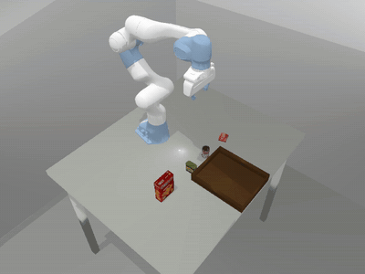<br><b>A2</b> · orientation-constrained packing</td>
<td align="center">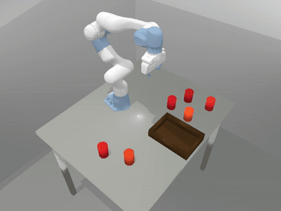<br><b>PKG5</b> · six YCB cans</td>
<td align="center">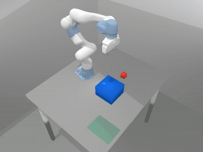<br><b>PUSH1</b> · push, then stack</td>
</tr>
<tr>
<td align="center">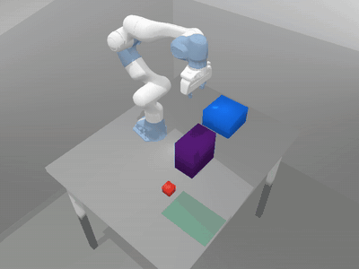<br><b>PUSH2</b> · detour push-stack</td>
<td align="center">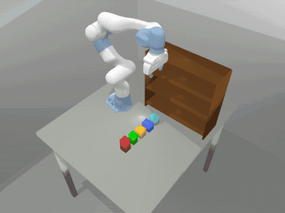<br><b>SHF2</b> · shelf placement</td>
<td align="center">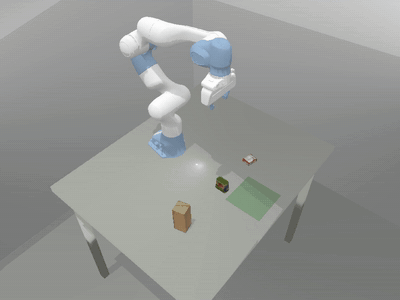<br><b>STK2</b> · three-block tower</td>
</tr>
<tr>
<td align="center">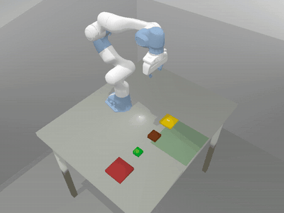<br><b>STK4</b> · four-disk stack</td>
<td align="center">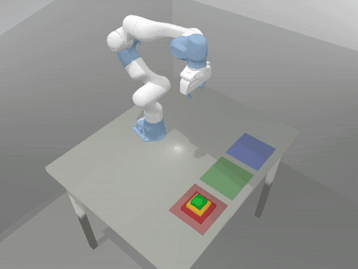<br><b>TOH1</b> · Tower of Hanoi, 3 disks</td>
<td align="center">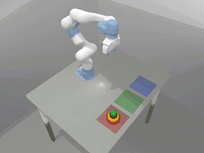<br><b>TOH4</b> · Tower of Hanoi, 4 disks</td>
</tr>
</table>

| ID | Scenario file | Task | Shortest plan |
|---|---|---|---|
| A1 | `A1_easy_few` | Place three objects in a spacious 0.42 × 0.21 m container | 6 |
| A2 | `A2_medium_mixed` | Pack four objects into a 0.32 × 0.26 m container, one orientation-constrained | 8 |
| PKG5 | `PKG5_six_exact_ycb_cans` | Pack six YCB-size cans with little clearance | 12 |
| PUSH1 | `PUSH1_push_base_stack_cube` | Push a non-graspable base into place, then stack a cube on it | 3 |
| PUSH2 | `PUSH2_blocked_detour_push_stack` | Push around an obstacle along a detour, then stack | 6 |
| SHF2 | `SHF2_medium_shelf` | Place five objects on a three-level shelf with side approaches | 10 |
| STK2 | `STK2_three_stack` | Build a stable three-block tower in the required order | 6 |
| STK4 | `STK4_pyramid` | Stack four disks largest-first from an incorrect order | 8 |
| TOH1 | `TOH1_hanoi_3disk` | Tower of Hanoi, seven legal transfers | 14 |
| TOH4 | `TOH4_4DiskCylinder` | Tower of Hanoi, fifteen legal transfers | 30 |

The scenario definitions are in [`envs/task_instances/foresight/`](envs/task_instances/foresight).

## Real robot

<table>
<tr>
<td align="center">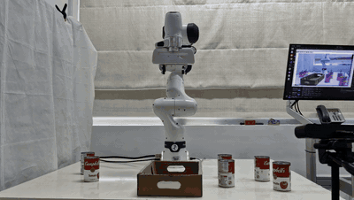<br><b>YCB packing</b> · 18/20 with rehearsal</td>
<td align="center">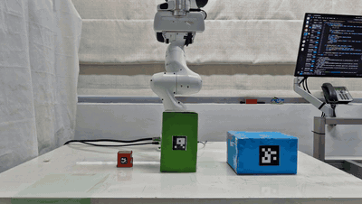<br><b>Obstacle-aware push-stack</b> · 17/20</td>
<td align="center">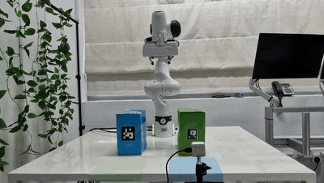<br><b>Multi-zone pushing</b> · 17/20</td>
</tr>
</table>

The GIFs are sped up. Full-length videos are on the [project page](https://muhayyuddin.github.io/forsight-tamp/).

---

## Repository layout

```
main_foresight.py        ForeSight-TAMP planning loop (plan, bind, rehearse, commit)
acfm.py                  Action-conditioned feasibility maps: domains, hard masks, soft ranking
rehearsal.py             Complete-plan rehearsal in a saved simulator state
cascade.py               Map-grounded failure feedback
run_foresight.py         Run one scenario (GUI or headless), optionally record a video
generate_results.py      Run methods × scenarios × trials for one model and summarise
baselines/               OWL-TAMP-, ViLaIn-TAMP- and VLM-TAMP-style adapters
planners/                LLM³ planner (LLM3-FS baseline)
envs/                    PyBullet environments and the ten scenario definitions
prompts/                 Prompt templates for environments, planners and tasks
configs/model_registry.py  The six language models and how to reach them
scripts/                 Multi-model benchmark, summaries, model setup, video recording
utils/                   PyBullet, motion-planning, LLM and metrics helpers
tests/                   Unit and integration tests
docs/                    Project page (GitHub Pages)
assets/                  Robot, container and object models
```

## Installation

Tested with Python 3.10 on Ubuntu 22.04.

```bash
git clone --recurse-submodules https://github.com/Muhayyuddin/forsight-tamp.git
cd forsight-tamp
python3 -m venv venv && source venv/bin/activate
pip install -r requirements.txt
```

The YCB object models are a submodule in `assets/ycb_objects`
([kwonathan/ycb_urdfs](https://github.com/kwonathan/ycb_urdfs)). If you cloned
without `--recurse-submodules`, fetch them with:

```bash
git submodule update --init assets/ycb_objects
```

Check the installation:

```bash
python3 -m pytest -q tests
```

## Language models

The paper uses six models. They are defined in
[`configs/model_registry.py`](configs/model_registry.py), and every script accepts
the registry key.

| Key | Model | Served by |
|---|---|---|
| `gpt-4o-mini` | GPT-4o-mini | OpenAI API |
| `gpt-3.5-turbo` | GPT-3.5-turbo | OpenAI API |
| `glm47-flash` | GLM-4.7-Flash (Q5_K_M, 21 GB) | Ollama |
| `qwen36-35b-a3b` | Qwen3.6-35B-A3B (UD-Q5_K_M, 27 GB) | Ollama |
| `mistral-small-24b` | Mistral-Small-3.2-24B (Q5_K_M, 17 GB) | Ollama |
| `llama33-70b` | Llama 3.3 70B Instruct (Q4_K_M, 43 GB) | Ollama |

All models run at temperature zero with at most ten LLM requests per trial.

**Hosted models.** Set your OpenAI key in the environment:

```bash
export OPENAI_API_KEY=sk-...
```

or put it in `openai_keys/openai_key.json` as `{"key": "sk-..."}`. That folder is
ignored by Git.

**Local models.** Install [Ollama](https://ollama.com), start `ollama serve`, then
download and register the GGUF weights. The local models were run one at a time on a
48 GB GPU.

```bash
python3 scripts/fetch_local_models.py --list              # what will be downloaded
python3 scripts/fetch_local_models.py --models glm47-flash
python3 scripts/import_local_models.py --models glm47-flash
python3 scripts/validate_models.py                        # one test request per model
```

Any OpenAI-compatible endpoint also works through `--llm-base-url` and
`--llm-api-key`.

## Run a single scenario

```bash
# Watch ForeSight-TAMP solve a scenario in the PyBullet GUI
python3 run_foresight.py --scenario SHF2_medium_shelf --model gpt-4o-mini

# Headless
python3 run_foresight.py --scenario A2_medium_mixed --model gpt-4o-mini --no-gui

# A local model served by Ollama
python3 run_foresight.py --scenario TOH1_hanoi_3disk --model qwen36-35b-a3b-q5km \
    --llm-base-url http://localhost:11434/v1 --llm-api-key ollama --llm-response-format off
```

`--scenario` takes any file name from `envs/task_instances/foresight/` without
`.json`. To switch modules off, pass `--disable acfm`, `--disable rehearsal` or
`--disable cascade`.

To render a 1080p video of the committed execution (headless, without the planning
process):

```bash
python3 run_foresight.py --scenario PUSH2_blocked_detour_push_stack --model gpt-4o-mini \
    --no-gui --play-traj --render-video videos/ --save-gif --close-when-done
```

## Reproduce the comparison (Table 6)

Five methods are compared: `LLM3-FS`, `OWL-TAMP`, `ViLaIn-TAMP`, `VLM-TAMP` (the
adapted baselines) and `ForeSight`. The paper runs every method on the ten scenarios
with six models and three trials each, 900 episodes in total. Trial `i` uses seed
`20260825 + i` for every method and model.

**All six models**, one after another:

```bash
python3 scripts/run_multi_model_benchmark.py --trials 3 --out-dir results/comparison
```

Each model's results go to `results/comparison/<model-key>/`. Add
`--models gpt-4o-mini qwen36-35b-a3b` to run a subset, and `--resume` to continue an
interrupted run.

**One model**:

```bash
python3 generate_results.py --model-key gpt-4o-mini --trials 3 --out-dir results/gpt-4o-mini
```

Narrow the run with `--methods ForeSight LLM3-FS` and `--scenarios A2 SHF2` (file
names or unique prefixes), or `--groups PACK PUSH SHF STK TOH` by task family. To
check the pipeline without calling a model, use `--dry-run`.

Each output directory contains:

| File | Contents |
|---|---|
| `raw_trials.json` | Every trial: success, LLM requests and tokens, motion-planner calls, timing, discarded primitives |
| `results.json`, `results_summary.csv` | Per-method, per-scenario summaries |
| `run_config.json` | Model, seeds, budgets and code provenance of the run |
| `traces/` | Per-trial event traces and the exact LLM prompts and replies |

Print a scenario-by-model table for one method:

```bash
python3 scripts/summarize_multimodel.py results/comparison --method ForeSight
```

## Reproduce the ablation (Table 8)

The factorial ablation turns the ACFM pipeline and complete-plan rehearsal on and off
with GPT-4o-mini and Qwen3.6-35B-A3B. The controls test the parts of the ACFM
pipeline.

| Method | Configuration |
|---|---|
| `Abl_base` | Base planner (no ACFM, no rehearsal) |
| `Abl_rehearsal_only` | Rehearsal only |
| `Abl_acfm_only` | ACFM only |
| `Abl_acfm_rehearsal` | ACFM and rehearsal |
| `Abl_no_ranking` | ACFM without soft ranking |
| `Abl_direct_top1` | Bind the top-ranked validated candidate, no LLM selection |
| `Abl_matched_rollout` | Validate unfiltered candidates under the same rollout quotas |

Cascading-failure analysis is off in every ablation configuration.

```bash
python3 scripts/run_multi_model_benchmark.py --models gpt-4o-mini qwen36-35b-a3b \
    --methods Abl_base Abl_rehearsal_only Abl_acfm_only Abl_acfm_rehearsal \
    --trials 3 --out-dir results/ablation

python3 scripts/run_multi_model_benchmark.py --models gpt-4o-mini qwen36-35b-a3b \
    --methods ForeSight Abl_no_ranking --trials 3 --out-dir results/ablation_ranking

python3 scripts/run_multi_model_benchmark.py --models gpt-4o-mini \
    --methods Abl_direct_top1 Abl_matched_rollout --trials 3 --out-dir results/ablation_controls
```

## Record the scenario videos

```bash
python3 scripts/record_paper_scenarios.py --model gpt-4o-mini --out-dir videos/
```

Each scenario is run headless and retried until it reaches the goal, and the
committed execution is rendered at 1920 × 1080. Add `--llm-base-url
http://localhost:11434/v1` and a local model name to record with Ollama.

## Citation

```bibtex
@article{uddin2026foresight,
  title   = {ForeSight-TAMP: Action-Conditioned Feasibility Maps for
             Spatially Grounded LLM Task and Motion Planning},
  author  = {Ud Din, Muhayy and Irfan, Mughni and Nader, Ahmed and
             Seneviratne, Lakmal and Hussain, Irfan},
  journal = {Preprint submitted to Elsevier},
  year    = {2026}
}
```

## Acknowledgements

The LLM3-FS baseline builds on [LLM³](https://github.com/AssassinWS/LLM-TAMP), and
the motion-planning utilities build on
[pybullet-planning](https://github.com/caelan/pybullet-planning). YCB object models
come from [ycb_urdfs](https://github.com/kwonathan/ycb_urdfs).

## License

[MIT](LICENSE)
